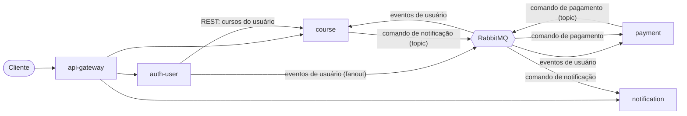

# Config Server

## Sobre o projeto

Servidor de configuração centralizada da plataforma EAD, baseado no Spring Cloud Config. Os microsserviços não guardam suas configurações: ao iniciar, buscam no Config Server, que as lê de um repositório Git ([ead-config-server-repo](https://github.com/LGui-santos/ead-config-server-repo)). O acesso é protegido por autenticação básica e o serviço se registra no Service Registry.

Projeto de portfólio com foco na infraestrutura de uma arquitetura de microsserviços.

## Funcionalidades

- Fornece as configurações de cada microsserviço, por nome e por perfil (`dev` e `prod`), a partir de um repositório Git
- Acesso protegido por usuário e senha (HTTP Basic), com credenciais definidas por configuração
- Registro no Service Registry (Eureka), para ser localizado pelos demais serviços pelo nome
- Suporte à criptografia de valores sensíveis (`{cipher}...`) no perfil de produção
- Suporte à atualização de configuração em tempo de execução nos clientes, pelo endpoint `refresh` do Actuator (usado no auth-user)

## Tecnologias utilizadas

- **Linguagem:** Java 21
- **Framework:** Spring Boot 4.1.1
- **Microsserviços:** Spring Cloud 2025.1.3 (Config Server, Eureka Client)
- **Segurança:** Spring Security (autenticação básica, senha com BCrypt)
- **Armazenamento das configurações:** Git (GitHub)
- **Build:** Maven

## Como executar o projeto

**Pré-requisitos:** Java 21, acesso à internet (o servidor lê as configurações do GitHub) e o [service-registry](https://github.com/LGui-santos/service-registry) no ar.

1. Clone o repositório e use a branch `dev`:
   ```bash
   git clone https://github.com/LGui-santos/config-server.git
   cd config-server
   git checkout dev
   ./mvnw spring-boot:run
   ```
2. O servidor sobe na porta `8888`. Para conferir, consulte as configurações de um serviço, informando o usuário e a senha definidos em `src/main/resources/application-dev.yaml`:
   ```bash
   curl -u <usuario>:<senha> http://localhost:8888/ead-authuser-service/dev
   ```
3. Para usar o seu próprio repositório de configurações, altere `spring.cloud.config.server.git.uri` no arquivo de perfil.

**Em produção** (branch `prod`), o serviço lê as variáveis de ambiente `PORT`, `CONFIG_SERVER_USERNAME`, `CONFIG_SERVER_PASSWORD`, `EUREKA_URL` e `APP_DOMAIN_NAME`. A chave de criptografia dos valores `{cipher}` deve ser fornecida por variável de ambiente (`ENCRYPT_KEY`).

## Organização do projeto

```
src/main
├── java/com/ead/configserver
│   ├── ConfigServerApplication.java      # @EnableConfigServer
│   └── configs/WebSecurityConfig.java    # usuário em memória e autenticação básica
└── resources
    ├── application.yaml                  # nome da aplicação e perfil ativo
    ├── application-dev.yaml              # execução local
    └── application-prod.yaml             # execução em produção
```

## O que este projeto demonstra

- Configuração centralizada e versionada com Spring Cloud Config
- Separação de configurações por serviço e por ambiente
- Proteção de infraestrutura com Spring Security
- Tratamento de valores sensíveis com criptografia e variáveis de ambiente
- Integração com Service Discovery

## Melhorias futuras

- Containerizar o serviço com Docker
- Usar um backend de segredos (como Vault) para os valores sensíveis
- Adicionar um webhook para atualizar os clientes automaticamente quando a configuração mudar (Spring Cloud Bus)

## Ecossistema EAD

Este projeto faz parte de uma plataforma de educação a distância (EAD) construída em microsserviços. Os serviços se descobrem pelo Eureka, buscam configuração no Config Server e se comunicam por REST e por mensageria (RabbitMQ).

| Serviço | Papel | Porta (dev) |
|---|---|---|
| [service-registry](https://github.com/LGui-santos/service-registry) | Service Discovery (Eureka Server) | 8761 |
| [config-server](https://github.com/LGui-santos/config-server) | Configuração centralizada (Spring Cloud Config) | 8888 |
| [ead-config-server-repo](https://github.com/LGui-santos/ead-config-server-repo) | Repositório de configurações dos serviços | - |
| [api-gateway](https://github.com/LGui-santos/api-gateway) | Ponto único de entrada | 8080 |
| [auth-user](https://github.com/LGui-santos/auth-user) | Usuários, autenticação e autorização | 8087 |
| [course](https://github.com/LGui-santos/course) | Cursos, módulos, lições e inscrições | 8082 |
| [payment](https://github.com/LGui-santos/payment) | Pagamentos com Stripe (em desenvolvimento) | 8086 |
| [notification](https://github.com/LGui-santos/notification) | Notificações aos usuários | 8084 |
| [notification-hexagonal](https://github.com/LGui-santos/notification-hexagonal) | Notificações em arquitetura hexagonal | 8084 |


